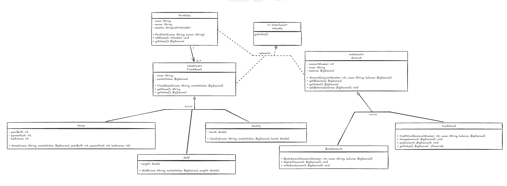

# Portfolio Manager
The portfolio manager is a command line app that allows the user to keep track of an update the value for components of their portfolio.

### Exercise Questions:
1. Did the deposit work for both accounts? Why or why not?
    1. No! Deposit did not work for both accounts, because account2 is declared as a Valuable, which does not have a deposit() method.
2. What methods are available for account1? 
   2. deposit(), withdraw(), and getValue()
3.  What methods are available for account2?
    3. getValue()
4. Why?
    4. The available methods are different because of how each account is declared. Account1 is a BankAccount object so it has access to bank account and valuable, but account2 is just a valuable.

### UML Diagram

